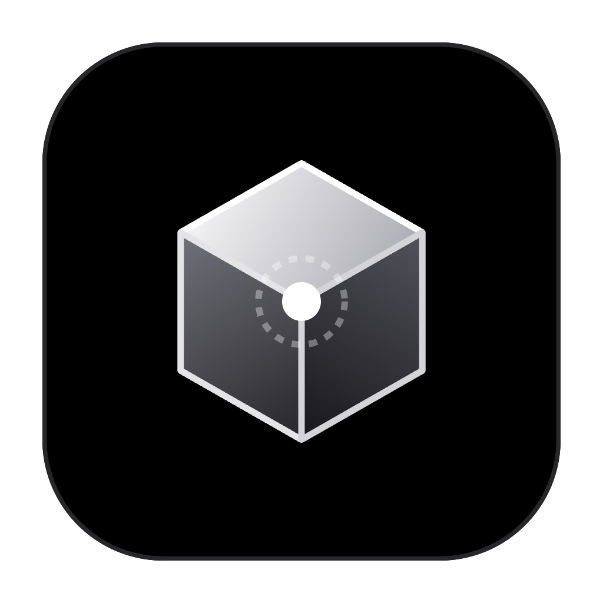

<div align="center">
  
  <h1>AUTONOMIC AI</h1>
  <p><b>Proof and workflow tools for autonomous coding agents.</b></p>
  <p><i>Allowlisted checks recorded as receipts, host gates that stop unverified claims, and deterministic YAML workflows. Built in Rust.</i></p>

  <p>
    <a href="https://github.com/autonomic-ai-dev/tekmor"></a>
    <a href="https://github.com/autonomic-ai-dev/agent-spine"></a>
    <a href="https://github.com/autonomic-ai-dev/homebrew-tap"></a>
    <a href="https://crates.io/crates/tekmor"></a>
    <a href="https://autonomic-ai.dev"></a>
  </p>
</div>

---

## Two Tools, Each on Its Own

Autonomic AI keeps proof and execution apart. Each tool installs and runs without the other:

* **`tekmor`** (v1.0.0): A proof eval for coding agents. It runs the commands your project allows, records each outcome against the commit and code it ran on, and writes a receipt. Claude Code hooks block a turn that claims a pass without a PASSED receipt, and block risky shell commands.
* **`agent-spine`**: The deterministic YAML workflow engine. It executes declarative Directed Acyclic Graphs (DAGs) with approval gates, isolated sandboxes, and a snapshot after every step.

---

## What tekmor Records

### 1. Allowlisted Checks Only
`tekmor verify -- <cmd>` runs only the commands listed in `.verify/verify.toml`. Each result is stored with the commit and a hash of the code that ran.

### 2. Receipts Tied to the Tree
`tekmor verify receipt` answers for the current code, not the last run. A change to any file that counts toward the tree, including the allowlist itself, makes an earlier pass stale.

### 3. Repeats and Ratchets
`tekmor verify --repeat N` marks a command flaky when its runs disagree on one tree, and flaky runs do not count as proof. `tekmor verify ratchet` stops lint counts from rising, and `tekmor verify drift` finds feature maps that point at code or checks that no longer exist.

### 4. Gates on the Host
`tekmor install` registers a stop gate and a bash gate in Claude Code. The stop gate blocks a turn that claims tests passed without a receipt. The bash gate blocks commands that skip git hooks or read the review key.

---

## Quickstart

### Homebrew (macOS, Apple Silicon)
```bash
brew tap autonomic-ai-dev/tap
brew install tekmor agent-spine
tekmor install
```

### Cargo
```bash
cargo install tekmor
tekmor install
```

Then, in a project:
```bash
tekmor verify init
tekmor verify -- .verify/run.sh
tekmor verify receipt
```

---

## Verification & Rigor

A claim that code works needs a PASSED receipt from `tekmor verify receipt` for the current tree. Test outputs and logs stay in `.verify/artifacts/`. Known limits, including who can sign a review, are listed in the [tekmor changelog](https://github.com/autonomic-ai-dev/tekmor/blob/master/CHANGELOG.md).

---

<div align="center">
  <sub>© 2026 Autonomic AI. Proof and workflow tools for autonomous coding agents.</sub>
</div>
