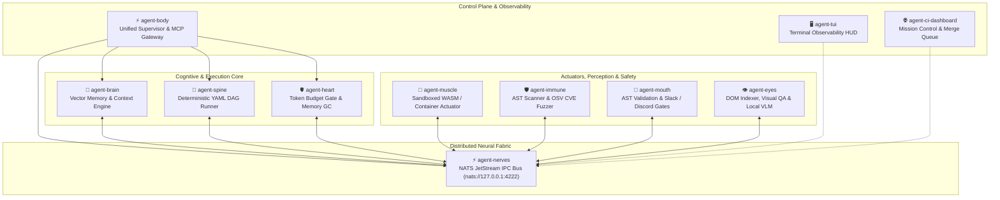

<div align="center">
  
  <h1>🧬 AUTONOMIC AI</h1>
  <p><b>The Unix Philosophy Applied to Autonomous Software Engineering.</b></p>
  <p><i>Structure beats intelligence. Deterministic execution over probabilistic hallucination. Zero telemetry. Built in Rust.</i></p>

  <p>
    <a href="https://github.com/autonomic-ai-dev/agent-body/releases"></a>
    <a href="https://github.com/autonomic-ai-dev/homebrew-tap"></a>
    <a href="https://rust-lang.org"></a>
    <a href="https://modelcontextprotocol.io"></a>
    <a href="https://nats.io"></a>
    
  </p>
</div>

---

## 🛑 The Problem: The Python Monolith Agent Trap

The first wave of autonomous AI agents (Devin, AutoGPT, Python multi-agent frameworks) hit three hard engineering walls:

1. **The Monolith Trap:** Bundling prompt synthesis, long-term memory, sandboxed execution, and state persistence inside a single massive Python event loop. A single unhandled exception or memory leak crashes the entire mission runtime.
2. **Context Collapse & Token Burn:** Shoveling 100K+ tokens into a single LLM prompt causes severe "Lost-in-the-Middle" drift, hallucinatory loops, and burns hundreds of dollars per task.
3. **Zero Data Sovereignty:** Enterprise engineering teams legally cannot stream proprietary codebases, database credentials, and unreleased IP to external black-box cloud runners.

---

## ⚡ The Solution: Biological Separation of Concerns

**Autonomic AI** replaces the brittle monolith with an **11-organ biological mesh**. Each organ is a high-performance, single-purpose binary written in pure Rust that communicates through standard **Model Context Protocol (MCP)** and a local **NATS JetStream** event bus.

By combining deterministic DAG workflows with precise, semantic memory filtering, Autonomic AI provides a structured, predictable multi-agent runtime optimized for local Apple Silicon and Linux execution with bounded token context and zero external telemetry.

---

## 🫀 The 11-Organ Architecture



---

## 🔬 The Organ Matrix

| Organ | Role | Technology | Primary Commands / Interfaces |
| :--- | :--- | :--- | :--- |
| **[`agent-body`](https://github.com/autonomic-ai-dev/agent-body)** | Organ supervisor, multi-host installer & unified MCP gateway | Rust, `rmcp` 1.7, tokio | `autonomic start`, `agent-body install --all`, `agent-body doctor` |
| **[`agent-brain`](https://github.com/autonomic-ai-dev/agent-brain)** | Low-latency memory router & semantic context engine (~500 tok budget) | Rust, SQLite, HNSW FastEmbed | `agent-brain route_task`, `agent-brain package add @skills`, `agent-brain briefing` |
| **[`agent-spine`](https://github.com/autonomic-ai-dev/agent-spine)** | Deterministic YAML DAG workflow orchestrator with HITL approval gates | Rust, petgraph, tokio | `agent-spine run --meta "task"`, `agent-spine init --with @workflow` |
| **[`agent-heart`](https://github.com/autonomic-ai-dev/agent-heart)** | API token budget guardrails, cost telemetry & scheduled memory GC | Rust, background daemon | `agent-heart status`, `agent-heart budget check`, `agent-heart gc` |
| **[`agent-muscle`](https://github.com/autonomic-ai-dev/agent-muscle)** | Sandboxed command execution, WASM runtimes & LoRA fine-tuning backends | Rust, Wasmtime, Docker | `agent-muscle run`, `agent-muscle serve`, `agent-muscle train` |
| **[`agent-immune`](https://github.com/autonomic-ai-dev/agent-immune)** | Pre-execution AST vulnerability scanner, OSV CVE fuzzer & runtime verification | Rust, tree-sitter, OSV API | `agent-immune scan`, `agent-immune sandbox run` |
| **[`agent-mouth`](https://github.com/autonomic-ai-dev/agent-mouth)** | Destructive command AST gatekeeper, Slack/Discord webhooks & human approvals | Rust, tree-sitter, webhooks | `agent-mouth validate`, `agent-mouth send --channel approvals` |
| **[`agent-eyes`](https://github.com/autonomic-ai-dev/agent-eyes)** | Token-efficient DOM layout indexer, pixel-diff visual QA & Candle local VLM | Rust, Candle LLaVA, Playwright | `agent-eyes capture`, `agent-eyes diff`, `agent-eyes describe-dom` |
| **[`agent-nerves`](https://github.com/autonomic-ai-dev/agent-nerves)** | Sub-millisecond distributed pub/sub event bridge & telemetry pipe | Rust, async-nats JetStream | `agent-nerves serve`, `agent-nerves ping`, `agent-nerves stream tail` |
| **[`agent-tui`](https://github.com/autonomic-ai-dev/agent-tui)** | Terminal Observability HUD (5-tab monitor: Overview, DAGs, Mesh, Brain, Logs) | Rust, ratatui 0.30, crossterm | `agent-tui`, `autonomic tui` |
| **[`agent-ci-dashboard`](https://github.com/autonomic-ai-dev/agent-ci-dashboard)** | Real-time cyber aerospace Mission Control, PR merge queue & automated CI monitor | SvelteKit 2, Tailwind, Vercel | [ci.autonomic.ai](https://github.com/autonomic-ai-dev/agent-ci-dashboard) |

---

## 🚀 Quickstart: Full Autonomous Mesh in 60 Seconds

### 1. Install via Homebrew (Apple Silicon & Linux)
```bash
# Tap official Autonomic repository
brew tap autonomic-ai-dev/tap

# Install entire 11-organ suite
brew install autonomic-stack
```

*Prefer modular installation? Install only what you need:*
```bash
brew install agent-brain   # Cognitive memory & MCP context router
brew install agent-body    # Supervisor & unified MCP gateway
brew install agent-tui     # Terminal Observability HUD
```

### 2. Scaffold Global Workspace
```bash
autonomic init
```

### 3. Connect to Your AI Editors & IDEs
Configure both `agent-body` (unified gateway) and `agent-brain` (context router) across your editor fleet in a single command:
```bash
# Configure Cursor, Claude Desktop, VS Code, Claude Code, OpenCode, Codex, Gemini & Antigravity
agent-body install --all
agent-brain install --all --global
```

*Or install to a specific editor:*
```bash
agent-body install cursor
agent-body install antigravity
agent-body install vscode
agent-body install claude-code
```

### 4. Launch Mission Control HUD
```bash
agent-tui
```

---

## 🔒 Why Developers Trust Autonomic AI

### 1. Deterministic Execution Over Stochastic Guessing
We never ask an LLM *"What should we do next?"* in an unbounded loop. **[`agent-spine`](https://github.com/autonomic-ai-dev/agent-spine)** enforces explicit, version-controlled YAML DAG workflows (`@bugfix`, `@feature-from-spec`, `@stacked-pr`). The LLM acts strictly as a worker bounded to isolated steps.

### 2. 500-Token Targeted Context Windows
Instead of spraying entire repositories into expensive 100K-token prompts, **[`agent-brain`](https://github.com/autonomic-ai-dev/agent-brain)** injects precisely ranked memory facts, AST nodes, and relevant skill rules under a strict ~500-token budget. Your models run faster, cheaper, and with near-zero hallucinations.

### 3. Zero Telemetry & Complete Sovereignty
Every database (`SQLite`), vector index (`HNSW`), state log, and IPC stream runs natively on your machine (`~/.autonomic/`). No telemetry, no cloud relays, no vendor lock-in.

### 4. Sub-Millisecond Rust Performance
Zero Python overhead. Every daemon, router, and watcher is compiled to native machine code (`aarch64-apple-darwin` & `x86_64-linux`), with sub-millisecond IPC state transitions and verified memory safety.

---

## 📦 Curated Skills & Workflow Packages

Discover, install, and compose curated agent capabilities from the official registry:
```bash
# List available skill bundles and workflows
agent-brain registry list

# Install curated skill sets
agent-brain package add @official          # Official Anthropic & Copilot skills
agent-brain package add @nextjs            # Vercel React & Next.js agent patterns
agent-brain package add @coding-policy     # Strict inspect-test-verify policy
agent-brain package add @claude-skills     # Curated Claude code skill library
```

---

## 🤝 Open Source & Contributing

Autonomic AI is completely open-source under the MIT license. Because each organ is decoupled and communicates via type-safe MCP interfaces, you can contribute to individual organs without having to learn the entire stack.

- 🐛 **Report Issues:** [GitHub Issues](https://github.com/autonomic-ai-dev/agent-body/issues)
- 💡 **Submit Workflows:** [agent-spine Workflows](https://github.com/autonomic-ai-dev/agent-spine)
- 📖 **Documentation:** [Ecosystem Specs & Guides](https://github.com/autonomic-ai-dev)

---

<div align="center">
  <sub>Built with precision by the Autonomic AI Team · Sovereign Software Engineering</sub>
</div>
